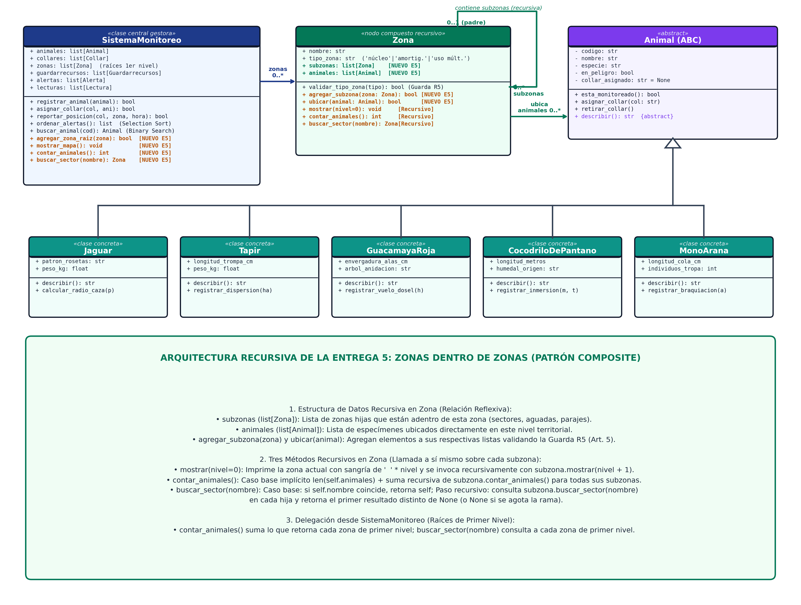
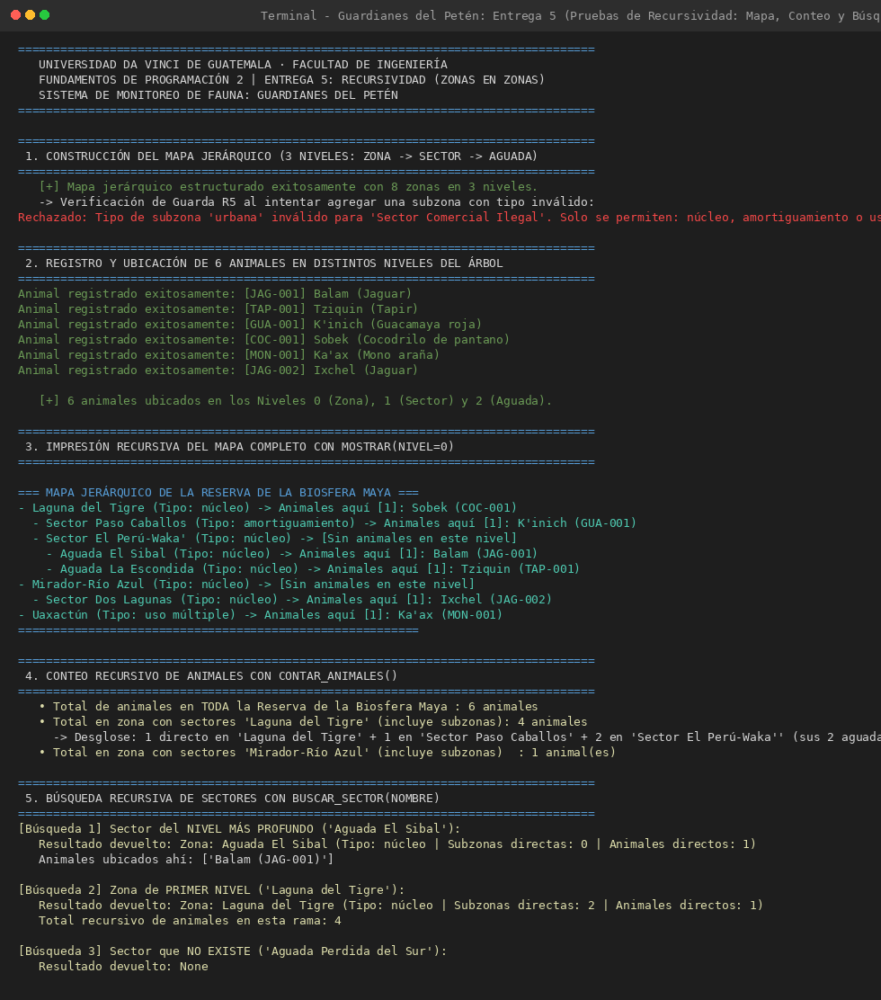
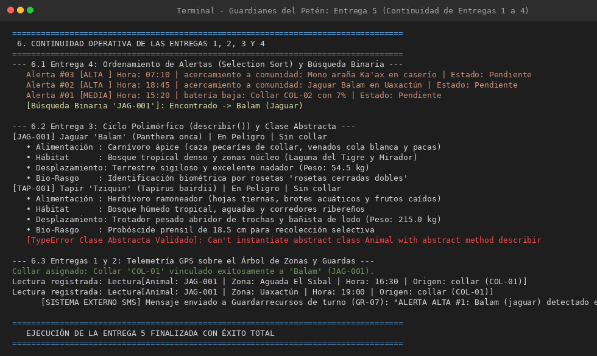

# Guardianes del Petén — Sistema de Monitoreo de Fauna
### Reserva de la Biosfera Maya · Universidad Da Vinci de Guatemala
**Facultad de Ingeniería · Fundamentos de Programación 2**

## 📌 Datos Generales de la Entrega

| Campo | Detalle |
| :--- | :--- |
| **Estudiante** | Samy Josue Ruiz Monzón |
| **Carné Universitario** | [Número de Carné] |
| **Curso** | Fundamentos de Programación 2 |
| **Grupo / Sección** | Sección A |
| **Entrega** | **Entrega 5 — Recursividad: Zonas dentro de zonas (Árbol territorial)** |
| **Fecha** | 15 de noviembre de 2026 |
| **Repositorio Oficial** | `https://github.com/samyruiz/guardianes-del-peten` *(Público)* |

## 📖 Descripción General de la Entrega 5

En esta **Entrega 5**, el sistema **Guardianes del Petén** modela la estructura territorial real de la Reserva de la Biosfera Maya mediante **recursividad y árboles n-arios (Patrón Composite)**: una zona de primer nivel (como *Laguna del Tigre*) puede contener sectores (como *Sector El Perú-Waka'*), los cuales a su vez contienen subsectores o aguadas (como *Aguada El Sibal* y *Aguada La Escondida*), sin límite fijo de profundidad.

Cada nodo de la clase `Zona` mantiene su propia lista de `subzonas` y de `animales` ubicados en ella, resolviendo las operaciones de visualización, conteo y búsqueda mediante **llamadas recursivas directas sobre cada subzona**:
1. **Estructura compuesta y guarda R5 (`agregar_subzona` y `ubicar`):** Agrega subzonas validando que su tipo cumpla el Artículo 5 (`núcleo`, `amortiguamiento` o `uso múltiple`) y ubica animales en cualquier nivel del árbol.
2. **Mapa jerárquico recursivo (`mostrar(nivel=0)`):** Imprime la zona actual con una sangría de `2 * nivel` espacios y se invoca a sí mismo con `nivel + 1` para cada subzona.
3. **Conteo recursivo de fauna (`contar_animales()`):** Suma los animales ubicados directamente en la zona (`len(self.animales)`) más el retorno recursivo de `subzona.contar_animales()` de todas sus subzonas. En `SistemaMonitoreo`, suma lo que devuelve cada zona de primer nivel.
4. **Búsqueda recursiva en profundidad (`buscar_sector(nombre)`):** Verifica primero el caso base (si la zona actual coincide con el nombre buscado, se devuelve a sí misma `self`); en el paso recursivo, consulta a cada subzona y retorna la primera respuesta distinta de `None` (o `None` si no se encuentra en ninguna rama).

## 📐 1. Diagrama de Clases UML Actualizado (Entrega 5)

El diagrama de clases UML incorpora en `Zona` las listas `subzonas` y `animales`, los métodos `agregar_subzona()`, `ubicar()`, `mostrar(nivel=0)`, `contar_animales()` y `buscar_sector(nombre)`, la **relación reflexiva (auto-asociación `0..*`)** de `Zona` consigo misma, y los métodos delegadores en la clase central `SistemaMonitoreo`.



## ⚙️ 2. Implementación de los Métodos Recursivos

### 2.1 Clase `Zona` (`zona.py`)
```python
def mostrar(self, nivel: int = 0):
    sangria = "  " * nivel
    nombres_animales = ", ".join([f"{a.nombre} ({a.codigo})" for a in self.animales])
    info_animales = f" -> Animales aquí [{len(self.animales)}]: {nombres_animales}" if self.animales else " -> [Sin animales en este nivel]"
    print(f"{sangria}- {self.nombre} (Tipo: {self.tipo_zona}){info_animales}")

    for subzona in self.subzonas:
        subzona.mostrar(nivel + 1)

def contar_animales(self) -> int:
    total = len(self.animales)
    for subzona in self.subzonas:
        total += subzona.contar_animales()
    return total

def buscar_sector(self, nombre: str):
    if self.nombre.lower() == nombre.strip().lower():
        return self

    for subzona in self.subzonas:
        encontrado = subzona.buscar_sector(nombre)
        if encontrado is not None:
            return encontrado

    return None
```

### 2.2 Clase Central `SistemaMonitoreo` (`sistema_monitoreo.py`)
```python
def contar_animales(self) -> int:
    total = 0
    for zona_raiz in self.zonas:
        total += zona_raiz.contar_animales()
    return total

def buscar_sector(self, nombre: str) -> Zona:
    for zona_raiz in self.zonas:
        encontrado = zona_raiz.buscar_sector(nombre)
        if encontrado is not None:
            return encontrado
    return None
```

## 📂 3. Estructura de Archivos del Repositorio

```text
guardianes-del-peten/
│
├── animal.py                    # Clase abstracta base Animal (ABC) con describir()
├── jaguar.py                    # Clase concreta Jaguar (Panthera onca)
├── tapir.py                     # Clase concreta Tapir (Tapirus bairdii)
├── guacamaya_roja.py            # Clase concreta GuacamayaRoja (Ara macao)
├── cocodrilo_de_pantano.py      # Clase concreta CocodriloDePantano (Crocodylus moreletii)
├── mono_arana.py                # Clase concreta MonoArana (Ateles geoffroyi)
├── collar.py                    # Clase Collar GPS de telemetría
├── zona.py                      # Clase Zona recursiva (subzonas, animales, mostrar, contar, buscar)
├── guardarrecursos.py           # Clase Guardarrecursos oficial
├── lectura.py                   # Clase Lectura de movimiento o avistamiento
├── alerta.py                    # Clase Alerta con prioridad y hora
├── servicio_sms.py              # Simulador de despacho de mensajería SMS
├── sistema_monitoreo.py         # Clase central gestora (recursividad, selección, búsqueda binaria, guardas)
├── main.py                      # Programa principal con las pruebas de la Entrega 5 y continuidad 1-4
├── diagrama_clases_e5.png       # Diagrama de Clases UML actualizado (Entrega 5)
├── captura_e5_recursividad.png  # Evidencia de ejecución: Mapa recursivo, conteo y búsquedas
├── captura_e5_continuidad.png   # Evidencia de ejecución: Continuidad de Entregas 1 a 4
└── README.md                    # Documentación oficial del repositorio
```

## 🖥️ 4. Evidencia de Ejecución de `main.py`

### 4.1 Pruebas de Recursividad (Mapa de 3 Niveles, Conteo y Búsqueda de Sectores)
1. **Mapa de 3 niveles y 8 zonas:**
   * `Laguna del Tigre` (Nivel 0) $\rightarrow$ `Sector Paso Caballos` (Nivel 1) y `Sector El Perú-Waka'` (Nivel 1) $\rightarrow$ `Aguada El Sibal` (Nivel 2) y `Aguada La Escondida` (Nivel 2).
   * `Mirador-Río Azul` (Nivel 0) $\rightarrow$ `Sector Dos Lagunas` (Nivel 1).
   * `Uaxactún` (Nivel 0).
2. **6 animales ubicados en distintos niveles:** `Sobek` y `Ka'ax` en Nivel 0; `K'inich` e `Ixchel` en Nivel 1; `Balam` y `Tziquin` en el Nivel 2 (más profundo).
3. **Conteo recursivo:** `6` animales en toda la reserva; `4` animales en `Laguna del Tigre` y sus subzonas; `1` animal en `Mirador-Río Azul`.
4. **Tres búsquedas recursivas:** `Aguada El Sibal` (nivel más profundo), `Laguna del Tigre` (primer nivel) y `Aguada Perdida del Sur` (inexistente $\rightarrow$ `None`).



### 4.2 Continuidad Operativa de las Entregas 1 a 4
Se comprueba que el ordenamiento por selección de alertas (`ordenar_alertas()`), la búsqueda binaria de animales (`buscar_animal()`), el ciclo polimórfico (`describir()`), la validación de clase abstracta (`TypeError`) y los reportes de telemetría GPS con alertas SMS siguen funcionando íntegramente.



## 🚀 5. Ejecución Local

```bash
git clone https://github.com/samyruiz/guardianes-del-peten.git
cd guardianes-del-peten
python3 main.py
```
